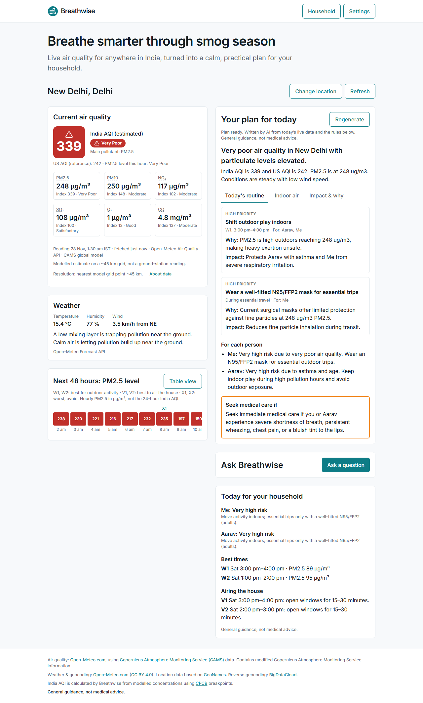
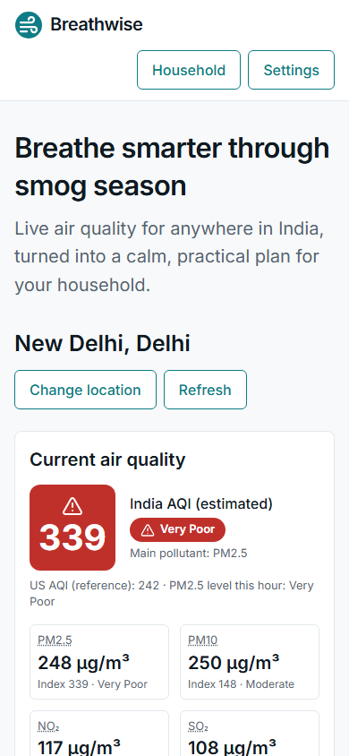
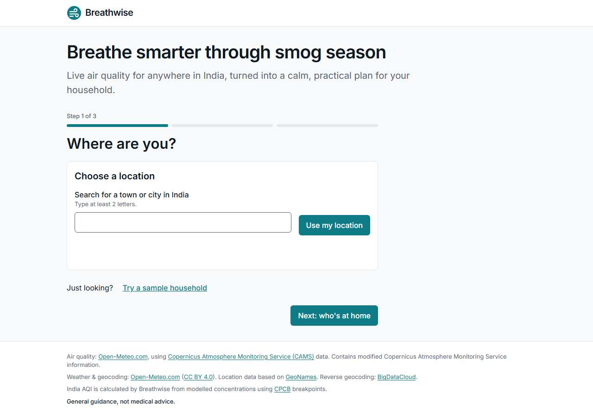

# Breathwise

**Breathe smarter through smog season.** Breathwise is a GenAI-powered air-quality assistant for India. It reads **live** air-quality and weather data for wherever you are, works out India's AQI and the cleanest hours of your day, and turns that into a personalised plan for your household — what to reschedule, when to open the windows, how to run the purifier, which mask to wear, and *why* each step matters.

> Built for **Prompt Wars Virtual – Challenge 6: Urban Air Quality Assistant**.

- **Live demo:** https://breathwise.pages.dev
- **Demo video:** _VIDEO LINK HERE_
- **Repository:** https://github.com/joedanields/Breathwise
- **Test scenarios for evaluators:** [`docs/TEST_SCENARIOS.md`](docs/TEST_SCENARIOS.md)

---

## What it does

| Pillar | What you get |
|---|---|
| **Low-emission daily routine** | Time-blocked plan: move outdoor activity to the cleanest window, commute alternatives, carpooling, errand bundling, mask advice per person |
| **Indoor air guidance** | Purifier on/off schedule and setting, ventilation windows, sealing and filtration hacks, cooking-ventilation tips, honest notes on what *doesn't* help much |
| **Impact & justification** | Every recommendation explains the health effect for the specific household member and, where relevant, the emissions saved (computed, not guessed) |

Plus: India AQI (NAQI) card, 48-hour forecast timeline with best outdoor/ventilation windows highlighted, and a grounded follow-up chat ("Can my 4-year-old play outside at 5 pm?").

### Screenshots

| Dashboard (live data, New Delhi) | Mobile, 390 px | Onboarding |
|---|---|---|
|  |  |  |

### Who it's for
Parents of young children · senior citizens · daily commuters / working professionals · students — and mixed households with several of these at once.

### Pan-India
Detect your location via GPS or search any city, town or district in India. Nothing is hard-coded to one city.

## How it works

```
Live APIs ─► typed snapshot ─► deterministic rules (NAQI, windows, CO₂) ─► Gemini (interprets) ─► validated plan
```

**Code computes, AI interprets.** Every number on screen comes from a live API response or a pure, unit-tested function. Gemini only receives those facts and writes the personalised plan and reasoning; it never produces AQI values. If Gemini is unavailable, a rules-based plan is shown instead.

Details: [`docs/ARCHITECTURE.md`](docs/ARCHITECTURE.md) · [`docs/AI_DESIGN.md`](docs/AI_DESIGN.md)

## Tech stack

Vite · React · TypeScript · Tailwind CSS · Radix UI · TanStack Query · Zod · Gemini API (REST) · Cloudflare Pages + Pages Functions · Vitest · React Testing Library · MSW · Playwright · axe-core

## Quick start

```bash
git clone https://github.com/joedanields/Breathwise.git
cd Breathwise
npm ci

# Option A – full stack locally (AI via the Pages Function)
cp .dev.vars.example .dev.vars      # add your GEMINI_API_KEY (file is git-ignored)
npm run build && npm run dev:api    # terminal 1: wrangler on :8788
npm run dev                         # terminal 2: Vite on :5173, proxies /api

# Option B – UI only, bring your own key
npm run dev                         # open Settings → "Use my own Gemini key"
```

Requires Node 22.22.2 or newer (see `.nvmrc`). On Windows, run the npm scripts from PowerShell.

### Environment

| Name | Where | Purpose |
|---|---|---|
| `GEMINI_API_KEY` | Cloudflare secret / `.dev.vars` | Server-side Gemini key used by `/api/advise` |
| `GEMINI_MODEL` | Cloudflare var / `.dev.vars` | Model id; currently `gemini-3.5-flash-lite` ([ADR-013](docs/DECISIONS.md)) |
| `ALLOWED_ORIGINS` | Cloudflare var / `.dev.vars` | Comma-separated origins allowed to call `/api/advise` |
| `RATE_LIMIT_KV` | KV binding | Per-IP rate limiting for `/api/advise` |

No API keys are needed for air-quality, weather or geocoding data.

### Scripts

`dev`, `dev:api`, `build`, `preview`, `lint`, `typecheck`, `test`, `test:cov`, `e2e`, `check` — see [`CLAUDE.md`](CLAUDE.md).

## Data sources & attribution

- **Air quality:** [Open-Meteo Air Quality API](https://open-meteo.com/en/docs/air-quality-api), based on Copernicus Atmosphere Monitoring Service (CAMS) global forecasts. Contains modified Copernicus Atmosphere Monitoring Service information.
- **Weather:** [Open-Meteo Forecast API](https://open-meteo.com/en/docs).
- **Place search:** [Open-Meteo Geocoding API](https://open-meteo.com/en/docs/geocoding-api).
- **Reverse geocoding:** [BigDataCloud free client-side API](https://www.bigdatacloud.com/free-api/free-reverse-geocode-to-city-api).
- **Place names:** location data based on [GeoNames](https://www.geonames.org/).

Open-Meteo data is licensed under CC BY 4.0. Values are **modelled estimates** on a ~45 km grid, not readings from a ground monitoring station; the app says so wherever values appear. India AQI is computed in-app from these concentrations using CPCB breakpoints. See [`docs/DATA_SOURCES.md`](docs/DATA_SOURCES.md).

## Quality

- **Security:** no secrets in repo, server-side key behind an origin-checked, rate-limited proxy, strict CSP, AI output rendered as text only. [`docs/SECURITY.md`](docs/SECURITY.md)
- **Testing:** 619 unit and component tests (coverage ≈ 99 % lines; `src/lib` and `shared` ≥ 90 % lines and branches), Playwright E2E journeys on Chromium, Firefox, WebKit and a 360 px mobile viewport, axe on every screen in light and dark, and a CSP-violation check — all in CI. E2E never calls live APIs. [`docs/TESTING.md`](docs/TESTING.md)
- **Sources:** every NAQI breakpoint and emission factor is checked against its primary source, with a "Source status" in [`docs/AQI_AND_RULES.md`](docs/AQI_AND_RULES.md).
- **Accessibility:** WCAG 2.2 AA target, keyboard-complete, colour never the only signal. [`docs/UI_UX.md`](docs/UI_UX.md)

## How GenAI was used

- **Building:** developed with Claude Code using the specs in `docs/` (prompt-driven development).
- **Runtime:** Gemini interprets live data into personalised advice, under a numeric grounding guard (every number must come from the facts) with a rules-based fallback. Prompt history and live evaluations: [`docs/PROMPT_LOG.md`](docs/PROMPT_LOG.md).

## Disclaimer

Breathwise provides general wellbeing guidance, not medical advice. If you or someone in your household has severe breathlessness, chest pain or other worrying symptoms, contact a doctor or emergency services.

## License

MIT — see `LICENSE`.
